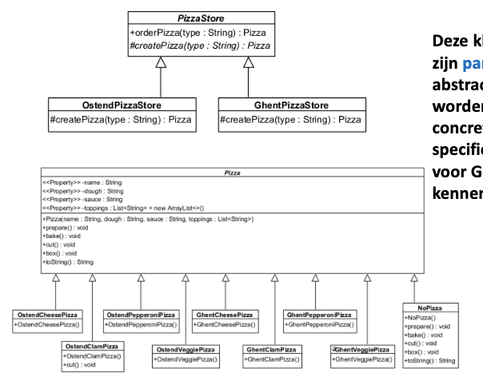
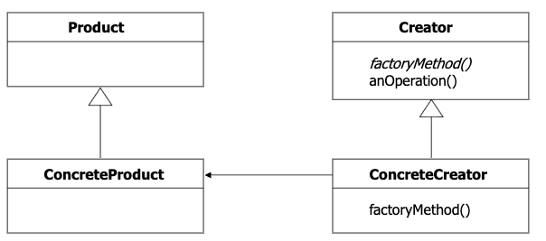
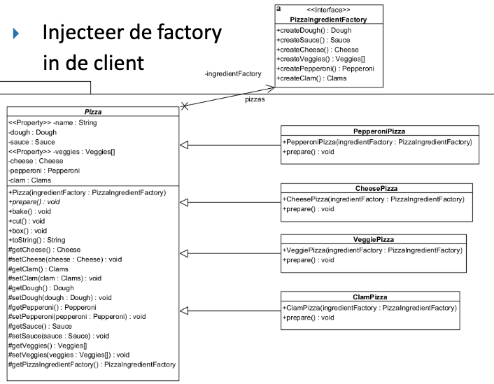
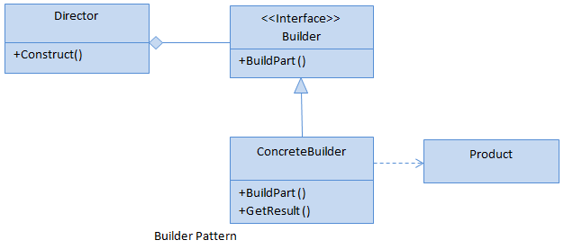

# 1. Design Patterns
## 1.1 Factory Pattern
### Factory Method
[VIDEO](https://www.youtube.com/watch?v=EdFq_JIThqM)
### 1.1.1 Gebruik
Gebruik dit als je **één object** wilt maken, maar de keuze voor de precieze versie pas door een subklasse wilt laten maken.
### 1.1.2 Voorbeeld
Pizza-keten die bepaalde pizzas enkel op bepaalde vestigingen maakt (Gent (standaard), Oostende (vis), ...)
### 1.1.3 Stappen
- **Stap 1:** Maak een **interface of abstracte klasse** voor het **Product**
- **Stap 2:** Maak de **Concrete Producten** die deze interface implementeren
- **Stap 3:** Maak een **abstracte Creator klasse**
- **Stap 4:** Declareer in deze Creator de **abstracte Factory Method**
- **Stap 5:** Schrijf in de Creator een gewone methode die de Factory Method aanroept om een object te krijgen en er acties op uitvoert.
- **Stap 6:** Maak **Concrete Creators** (subklassen) die de Factory Method overschrijven om het specifieke object terug te geven.
### 1.1.4 UML

**ALGEMENE UML**

### 1.1.5 Code TODO 

## Abstract Factory 
[VIDEO](https://www.youtube.com/watch?v=QNpwWkdFvgQ)
[CHAMILO UITLEG](https://chamilo.hogent.be/index.php?go=CourseViewer&application=Chamilo%5CApplication%5CWeblcms&course=64843&tool=Document&publication_category=350637&browser=Table&tool_action=Viewer&publication=2540994)
### 1.2.1 Gebruik
Gebruik dit als je een hele **set van bijpassende producten** (een familie, zoals alle ingrediënten voor een pizza) tegelijk moet maken zonder de exacte klassen te hoeven kennen.
### 1.2.2 Voorbeeld
**Interface-fabriek** die knoppen en vensters maakt voor verschillende besturingssystemen (Windows en Mac):
Je code maakt een knop en de fabriek zorgt ervoor dat deze wordt aangepast aan het besturingssysteem.
### 1.2.3 Stappen
- **Stap 1:** Maak per gedrag een interface
- **Stap 2:** Maak voor elke familie de concrete klassen aan
- **Stap 3:** Maak een abstracte factory. Voeg een create method toe per soort object (kolom).
- **Stap 4:** Maak per familie een concrete factory
- **Stap 5:** Injecteer de factoryin de client
### 1.2.4 UML

### 1.2.5 Code TODO 

## 1.2 Builder Pattern
**[Builder Design Pattern: Easy Guide for Beginners](https://www.youtube.com/watch?v=Wqx4N4tV_tc)
[The Builder Pattern Explained and Implemented in Java | Creational Design Patterns | Geekific](https://www.youtube.com/watch?v=MaY_MDdWkQw)
[Builder Design Pattern in Java Theory](https://www.youtube.com/watch?v=KbIdk5BRn0w)**
#### 1.2.1 Gebruik
Gebruik dit als je een **complex object stap voor stap** wilt opbouwen.
Ideaal als je object heel veel verschillende configuraties kan hebben en geen messy constructor met 10 parameters wilt.
#### 1.2.2 Voorbeeld
Een **PC samenstellen**: Je kunt kiezen welke CPU, hoeveel RAM, welke videokaart en of je wel of geen RGB-verlichting wilt. In plaats van één gigantische constructor, gebruik je een builder waarbij je zegt: `.addCPU("Ryzen 9")`, `.addRAM(32)`, `.enableRGB()`, en pas aan het einde `.build()`.
### 1.2.3 Stappen
- **Stap 1:** Maak de Builder interface
- **Stap 2:** Maak de implementatieklassen (Concrete Builders)
- **Stap 3:** Maak de Product klasse
- **Stap 4:** Maak de Director klasse
### 1.2.4 UML

### 1.2.5 Code TODO

## 1.3 Adapter Pattern
[The Adapter Pattern Explained and Implemented in Java](https://www.youtube.com/watch?v=wA3keqCeKtM)
[Adapter Design Pattern in Java Theory](https://www.youtube.com/watch?v=5-xqFjo_jC8&pp=ygUbYWRhcHRlciBkZXNpZ24gcGF0dGVybiBqYXZh0gcJCa4KAYcqIYzv "Adapter Design Pattern in Java Theory")
[Adapter Design Pattern in Java](https://www.youtube.com/watch?v=Y7DYhe6efQY&pp=ygUbYWRhcHRlciBkZXNpZ24gcGF0dGVybiBqYXZh "Adapter Design Pattern in Java")
### 1.3.1 Gebruik
Wordt gebruikt wanneer je iets moet omzetten in iets anders

### 1.3.2 Voorbeeld

Adapter pattern is zoals een een male USB A naar female USB C adapter. Het is nodig om de twee apparaten te verbinden want het ene apparaat heeft enkel USB A kabel en het andere apparaat heeft enkel een USB C poort.

Ander voorbeeld is een tolk. De ene persoon praat Spaans en de andere verstaat geen Spaans. Ze huren een tolk die Spaans vertaalt naar Nederlands. De Spanjaard praat tegen de tolk en de tolk zet dit om naar het Nederlands.

**Ander voorbeeld is hieronder**

Voor een Kalkoen toe te voegen aan het project dat oorspronkelijk enkel voor een Eend was gemaakt, heb je de KalkoenAdapter nodig die een Eend omzet in een Kalkoen

### 1.3.3 Stappen
- **Stap 1:** Maak de Target interface die de gewenste functionaliteit definieert voor de client.
- **Stap 2:** Identificeer de Adaptee klasse die de bestaande, maar incompatibele code bevat.
- **Stap 3:** Maak de Adapter klasse die de Target interface implementeert.
- **Stap 4:** Voeg een referentie van de Adaptee toe aan de Adapter klasse middels compositie.
- **Stap 5:** Koppel de Target methoden in de Adapter aan de specifieke logica van de Adaptee.
### 1.3.4 Algemene UML

### 1.3.5 Code TODO

## 1.4 Singleton Pattern
[The Singleton Pattern Explained and Implemented in Java | Creational Design Patterns | Geekific](https://www.youtube.com/watch?v=tSZn4wkBIu8&pp=ygUdc2luZ2xldG9uIGRlc2lnbiBwYXR0ZXJuIGphdmE%3D "The Singleton Pattern Explained and Implemented in Java | Creational Design Patterns | Geekific")[Singleton Design Pattern: Easy Guide for Beginners](https://www.youtube.com/watch?v=412kLiN9PQU&pp=ygUdc2luZ2xldG9uIGRlc2lnbiBwYXR0ZXJuIGphdmE%3D "Singleton Design Pattern: Easy Guide for Beginners")

### 1.4.1 Gebruik

* Er bestaat maar 1 instantie van
* Het object is overal beschikbaar in de applicatie
* Ipv. elke keer het object opnieuw te maken, wordt het object hergebruikt
* Wordt gebruikt voor multithreading (niet zeker of we dit moeten kennen of niet)
### 1.4.2 Voorbeeld

Een land kan maar 1 president hebben. Meer dan 1 president kan niet. Het wordt dus gelimiteerd op 1!

### 1.4.3 Stappen
- **Stap 1:** Maak de klasse aan die slechts één instantie mag hebben (de Singleton klasse).
- **Stap 2:** Maak een **private static** variabele van hetzelfde klassetype aan binnen de klasse om de enige instantie op te slaan.
- **Stap 3:** Zet de **constructor op private**, zodat de klasse niet van buitenaf geïnstantieerd kan worden met het `new` keyword.
- **Stap 4:** Schrijf een **public static** methode (meestal `getInstance()`) die fungeert als het centrale toegangspunt tot de instantie.
- **Stap 5:** Implementeer logica in deze methode die controleert of de instantie al bestaat: zo ja, geef deze terug; zo nee, maak de instantie aan en geef deze terug (**lazy initialization**).
### 1.4.4 UML

![[img/Pasted image 20260309145827.png]]
### 1.4.5 Code TODO

## 1.5 Iterator Pattern
[The Iterator Pattern Explained and Implemented in Java | Behavioral Design Patterns | Geekific](https://www.youtube.com/watch?v=QCWJWfuAfJc&pp=ygUcaXRlcmF0b3IgZGVzaWduIHBhdHRlcm4gamF2YQ%3D%3D "The Iterator Pattern Explained and Implemented in Java | Behavioral Design Patterns | Geekific")
[Iterator Design Pattern: Easy Guide for Beginners](https://www.youtube.com/watch?v=9l8PJ__Cg_Y&pp=ygUcaXRlcmF0b3IgZGVzaWduIHBhdHRlcm4gamF2YQ%3D%3D "Iterator Design Pattern: Easy Guide for Beginners")
[CHAMILO](https://chamilo.hogent.be/index.php?go=CourseViewer&application=Chamilo%5CApplication%5CWeblcms&course=64843&tool=Document&publication_category=350639&browser=Table&tool_action=Viewer&publication=2540967)

### 1.5.1 Gebruik

- Biedt een uniforme manier om over verschillende soorten collecties te itereren.
- Ontkoppelt de client (de "Waitress") van de concrete implementatie van de data (zoals `ArrayList` of `Array`).
- Maakt het mogelijk om polymorfisme te gebruiken bij het doorlopen van verzamelingen.

### 1.5.2 Voorbeeld

Een serveerster wil de menu's van zowel het _Pancake House_ (gebruikt een `ArrayList`) als het _Diner_ (gebruikt een `Array`) afdrukken. Zonder Iterator moet zij voor elk menu een aparte lus schrijven (één voor de lijst en één voor de array). Met een Iterator kan zij beide menu's op exact dezelfde manier doorlopen.

### 1.5.3 Stappen

- **Stap 1:** Definieer een `Iterator` interface met methoden zoals `hasNext()` en `next()`.
- **Stap 2:** Maak concrete Iterator-klassen (bijv. `DinerMenuIterator`) die deze interface implementeren voor een specifieke collectie.
- **Stap 3:** Definieer een gemeenschappelijke `Menu` interface die een methode `createIterator()` bevat.
- **Stap 4:** Implementeer de `createIterator()` methode in de concrete klassen (bijv. `DinerMenu`), zodat deze de juiste Iterator teruggeven.
- **Stap 5:** Pas de client (bijv. de `Waitress`) aan zodat deze enkel de `Iterator` interface gebruikt om door de items te lopen, ongeacht de bron.

### 1.5.4 UML

![[img/Pasted image 20260309150514.png]]
### 1.5.5 Code TODO

## 1.6 Composite Pattern

Het Composite pattern wordt gebruikt wanneer objecten in een boomstructuur (geheel-deel hiërarchie) georganiseerd zijn.

### 1.6.1 Gebruik

- Stelt clients in staat om individuele objecten en composities van objecten op een uniforme manier te behandelen.
- Wordt gebruikt om structuren van objecten weer te geven (zoals een menu dat sub-menu's bevat).
- Maakt recursieve structuren mogelijk waarbij een "geheel" zelf weer uit "delen" bestaat.

### 1.6.2 Voorbeeld

Een restaurantmenu kan bestaan uit losse gerechten (`MenuItems`), maar ook uit sub-menu's (bijv. een "Dessert menu" binnen het hoofdmenu). Met het Composite pattern kan de serveerster simpelweg `print()` aanroepen op het hoofdmenu, waarna de hele boomstructuur (inclusief alle sub-menu's en hun gerechten) recursief wordt afgedrukt.

### 1.6.3 Stappen

- **Stap 1:** Maak een abstracte `Component` klasse (bijv. `MenuComponent`) die de standaardoperaties definieert voor zowel de bladeren als de composities.
- **Stap 2:** Maak de `Leaf` klasse (bijv. `MenuItem`) die de `Component` uitbreidt en de specifieke logica voor individuele elementen implementeert.
- **Stap 3:** Maak de `Composite` klasse (bijv. `Menu`) die ook de `Component` uitbreidt, maar daarnaast een lijst van `Component` kinderen bijhoudt.
- **Stap 4:** Implementeer in de `Composite` klasse methoden om kinderen toe te voegen of te verwijderen (`add()`, `remove()`).
- **Stap 5:** Implementeer de hoofdoperatie (bijv. `print()`) in de `Composite` klasse zodanig dat deze de operatie delegeert aan al zijn kinderen (recursie).

### 1.6.4 UML

![[img/Pasted image 20260309150558.png]]
### 1.6.5 Code TODO