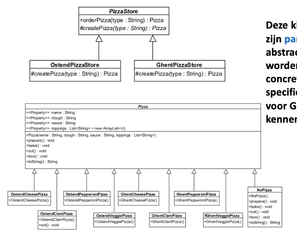
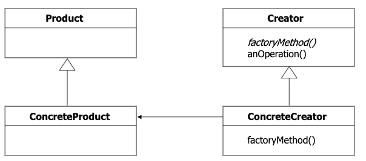
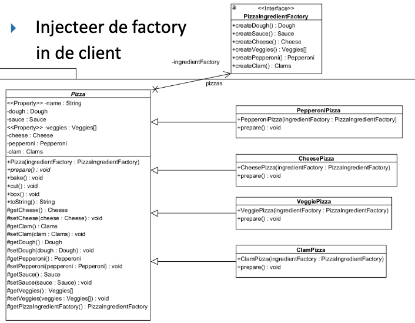
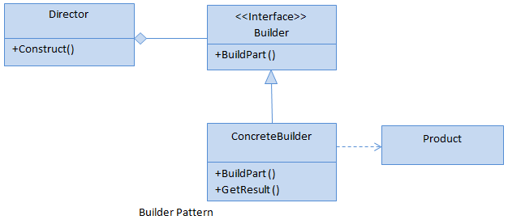

# 1. Design Patterns
## 1.1 Factory Pattern
### Factory Method
[VIDEO](https://www.youtube.com/watch?v=EdFq_JIThqM)
### 1.1.1 Gebruik
Gebruik dit als je **één object** wilt maken, maar de keuze voor de precieze versie pas door een subklasse wilt laten maken.
### 1.1.2 Voorbeeld
Pizza-keten die bepaalde pizzas enkel op bepaalde vestigingen maakt (Gent (standaard), Oostende (vis), ...)
### 1.1.3 Stappen
- **Stap 1:** Maak een **interface of abstracte klasse** voor het **Product**
- **Stap 2:** Maak de **Concrete Producten** die deze interface implementeren
- **Stap 3:** Maak een **abstracte Creator klasse**
- **Stap 4:** Declareer in deze Creator de **abstracte Factory Method**
- **Stap 5:** Schrijf in de Creator een gewone methode die de Factory Method aanroept om een object te krijgen en er acties op uitvoert.
- **Stap 6:** Maak **Concrete Creators** (subklassen) die de Factory Method overschrijven om het specifieke object terug te geven.
### 1.1.4 UML

**ALGEMENE UML**

### 1.1.5 Code TODO 

## Abstract Factory 
[VIDEO](https://www.youtube.com/watch?v=QNpwWkdFvgQ)
[CHAMILO UITLEG](https://chamilo.hogent.be/index.php?go=CourseViewer&application=Chamilo%5CApplication%5CWeblcms&course=64843&tool=Document&publication_category=350637&browser=Table&tool_action=Viewer&publication=2540994)
### 1.2.1 Gebruik
Gebruik dit als je een hele **set van bijpassende producten** (een familie, zoals alle ingrediënten voor een pizza) tegelijk moet maken zonder de exacte klassen te hoeven kennen.
### 1.2.2 Voorbeeld
**Interface-fabriek** die knoppen en vensters maakt voor verschillende besturingssystemen (Windows en Mac):
Je code maakt een knop en de fabriek zorgt ervoor dat deze wordt aangepast aan het besturingssysteem.
### 1.2.3 Stappen
- **Stap 1:** Maak per gedrag een interface
- **Stap 2:** Maak voor elke familie de concrete klassen aan
- **Stap 3:** Maak een abstracte factory. Voeg een create method toe per soort object (kolom).
- **Stap 4:** Maak per familie een concrete factory
- **Stap 5:** Injecteer de factoryin de client
### 1.2.4 UML

### 1.2.5 Code TODO 

## 1.2 Builder Pattern
**[Builder Design Pattern: Easy Guide for Beginners](https://www.youtube.com/watch?v=Wqx4N4tV_tc)
[The Builder Pattern Explained and Implemented in Java | Creational Design Patterns | Geekific](https://www.youtube.com/watch?v=MaY_MDdWkQw)
[Builder Design Pattern in Java Theory](https://www.youtube.com/watch?v=KbIdk5BRn0w)**
#### 1.2.1 Gebruik
Gebruik dit als je een **complex object stap voor stap** wilt opbouwen.
Ideaal als je object heel veel verschillende configuraties kan hebben en geen messy constructor met 10 parameters wilt.
#### 1.2.2 Voorbeeld
Een **PC samenstellen**: Je kunt kiezen welke CPU, hoeveel RAM, welke videokaart en of je wel of geen RGB-verlichting wilt. In plaats van één gigantische constructor, gebruik je een builder waarbij je zegt: `.addCPU("Ryzen 9")`, `.addRAM(32)`, `.enableRGB()`, en pas aan het einde `.build()`.
### 1.2.3 Stappen
- **Stap 1:** Maak de Builder interface
- **Stap 2:** Maak de implementatieklassen (Concrete Builders)
- **Stap 3:** Maak de Product klasse
- **Stap 4:** Maak de Director klasse
### 1.2.4 UML

### 1.2.5 Code TODO